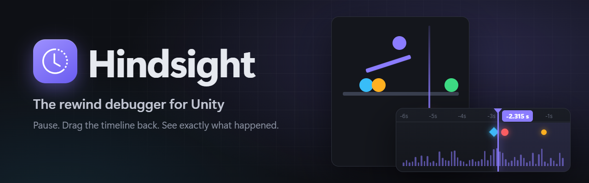
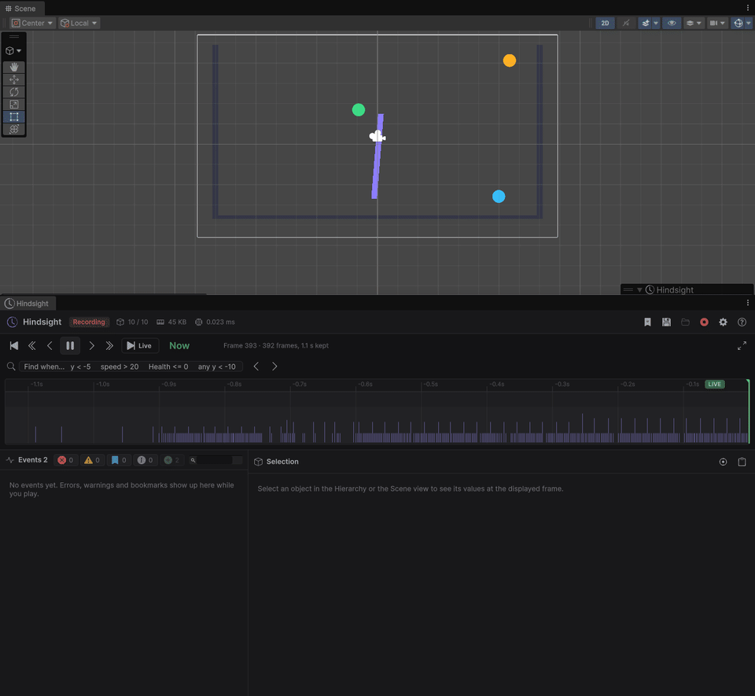
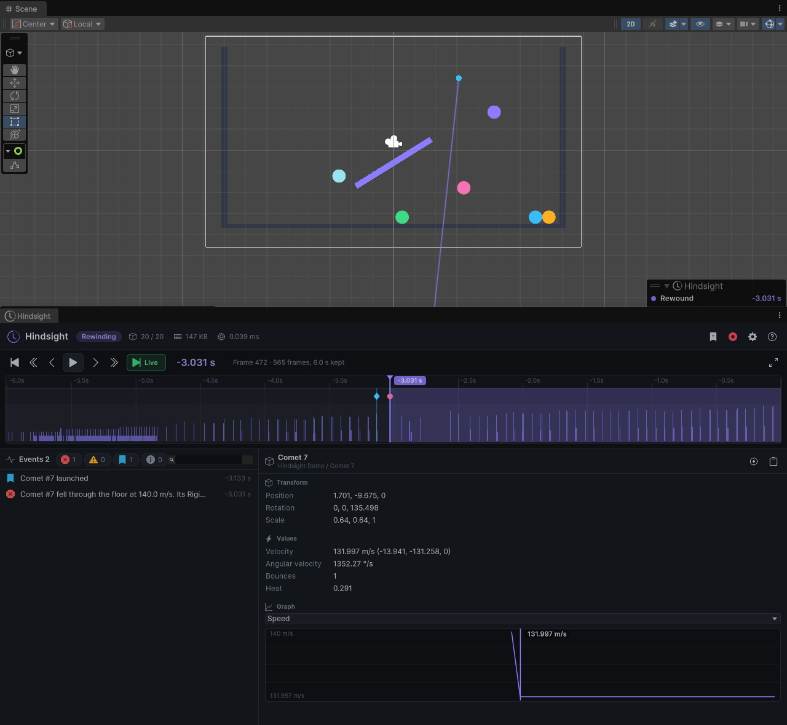
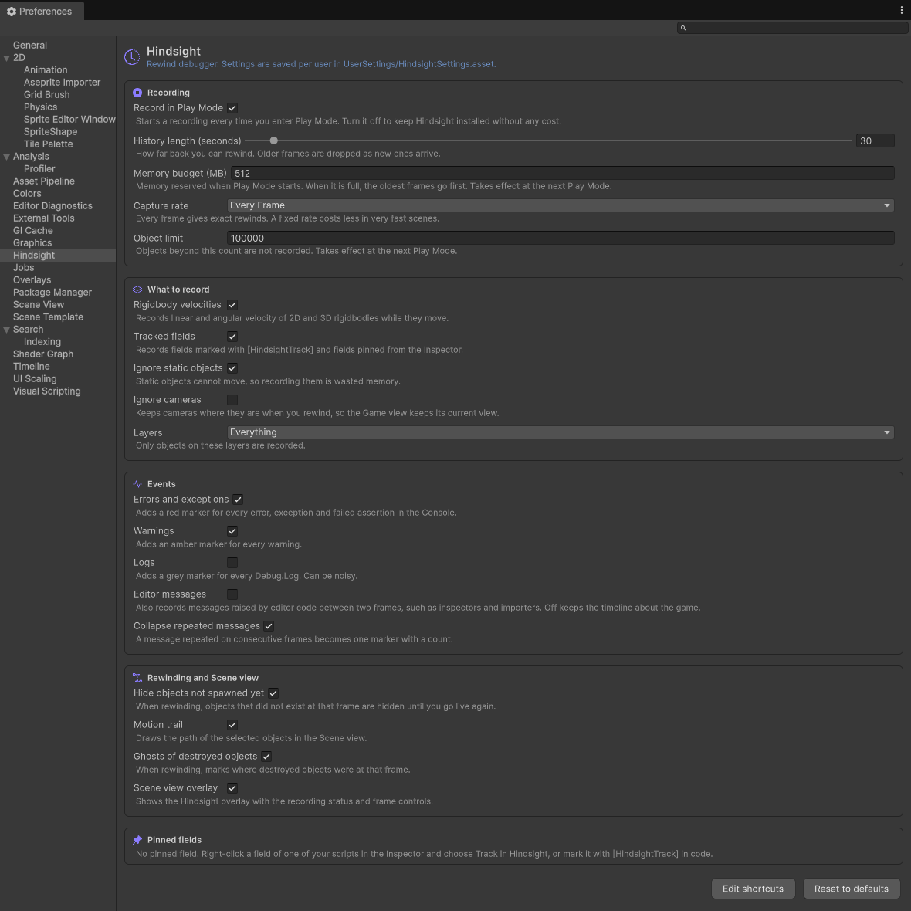

<p align="center">
  
</p>

<p align="center">
  
  <a href="https://github.com/Nekuzaky/Hindsight/releases"></a>
  
  
  
  <a href="LICENSE"></a>
</p>

<p align="center">
  <a href="https://github.com/sponsors/Nekuzaky"></a>
  <a href="https://www.patreon.com/Nekuzaky"></a>
  <a href="https://buymeacoffee.com/nekuzaky"></a>
</p>

**Hindsight** is a rewind debugger for the Unity Editor. It records your scene while you play. When something goes
wrong, you pause, drag the timeline back, and every object is exactly where it was, with the Console errors, your
bookmarks, the velocities and your own variables on the same timeline.

**Stop reproducing bugs. Rewind them.**

<p align="center">
  
</p>

<p align="center"><sub>A comet falls through the floor. Pause, click the red error marker, select the comet: its path goes
straight through the floor and the panel reads 140 m/s at that frame.</sub></p>

## Why

The most expensive part of debugging is not the fix, it is reproducing the bug. A ball that tunnels through a wall once
in twenty tries, an enemy that turns around for no reason, a jump that fails on one frame: by the time you notice, it
is gone, and you go back to adding `Debug.Log` everywhere and pressing Play again.

Hindsight keeps the last seconds of your game in memory, so you can look at the moment it happened instead of trying to
make it happen again.

## Features

- **Zero setup.** Install the package and press Play. No component, no code, no scene changes.
- **Rewind the real scene.** The objects themselves move back, so the Scene view and the Game view show the past with
  your real materials, lights and cameras. Objects that did not exist yet are hidden; destroyed ones leave a ghost.
  Resume, step or exit Play Mode and everything is back live.
- **A timeline that points at the problem.** Errors, exceptions, warnings and bookmarks are markers you click to jump
  to; an activity lane shows how much moved on each frame. Zoom, pan, step frame by frame, jump event to event.
- **Inspect any object at any frame.** Transform, Rigidbody and Rigidbody2D velocities, and your own fields, with a
  graph over the whole recording that never hides a one-frame spike.
- **Your variables on the timeline.** `[HindsightTrack]` on a field, or right-click it in the Inspector and choose
  **Track in Hindsight**. `Hindsight.Bookmark("...")` from code, or `F9`.
- **Motion trails** of the selected objects in the Scene view, with the errors marked on the path.
- **Stack traces you can click.** Every script line of an event's stack trace opens the script at that line.
- **Zero cost in builds.** Everything runs in an editor-only assembly; the attribute and the bookmark call are
  compiled out of player builds.
- **Light in the editor.** Burst jobs on worker threads, about 0.01 to 0.05 ms of main-thread time per frame for
  10,000 objects, and no garbage collection once warmed up.
- **Every option in Preferences**, saved per user so teammates do not step on each other.

<p align="center">
  
  &nbsp;
  
</p>

## Install

Requires **Unity 6000.3** or newer (Unity 6.3 LTS). Works with the built-in pipeline, URP and HDRP.

In Unity: **Window > Package Manager > + > Install package from git URL...** and paste:

```
https://github.com/Nekuzaky/Hindsight.git?path=Packages/com.nekuzaky.hindsight
```

Pin a release by adding its tag, for example `...?path=Packages/com.nekuzaky.hindsight#v1.0.0`.

## Quick start

1. Press **Play**.
2. Open **Tools > Hindsight > Open Hindsight** (`Ctrl+Alt+H`).
3. When something goes wrong, **pause** and drag the timeline back, or click a red marker.
4. Select an object to read its values at that frame. Press **Live** (or `End`) to come back.

To try it right away, import the **Bouncing Balls Demo** from the package's **Samples** tab and press Play: every
seventh ball is a comet that tunnels through the floor.

```csharp
using Nekuzaky.Hindsight;
using UnityEngine;

public class Enemy : MonoBehaviour
{
    [HindsightTrack] public float Health;                  // recorded every frame, plotted in the window
    [HindsightTrack("AI state")] private EnemyState _state;

    void OnPathFailed() => Hindsight.Bookmark("Path failed");   // blue marker on the timeline
}
```

## Performance

Measured in real Play Mode with `Tools/Benchmark.ps1` (1,800 frames per scenario at 60 fps, recording off then on,
Intel Core i7-14700KF, Unity 6000.3.13f1):

| Scenario | Hindsight per frame (avg / p95) | Memory for 30 s | GC per frame | Rewind to any frame |
|---|---:|---:|---:|---:|
| 10,000 objects, none moving | 0.012 / 0.019 ms | 1.2 MB | 0 B | 0.47 ms |
| 10,000 objects, 1,000 moving | 0.016 / 0.022 ms | 82 MB | 0 B | 2.1 ms |
| 10,000 objects, all moving | 0.050 / 0.083 ms | 368 MB | 0 B | 2.0 ms |
| 500 Rigidbody2D bodies | 0.020 / 0.062 ms | 10 MB | 0 B | 0.7 ms |
| 20 objects created and destroyed per frame | 0.130 / 0.200 ms | 51 MB | 0 B | 2.2 ms |

The full table, the memory model and the architecture are in
[Performance and how it works](Packages/com.nekuzaky.hindsight/Documentation~/performance.md).

## How it works, in short

Hindsight adds two systems to Unity's player loop when Play Mode starts. Right after `LateUpdate`, a Burst
`IJobParallelForTransform` reads every recorded transform on worker threads while the frame renders, and only the
transforms that changed are written to a fixed-size ring buffer. At the start of the next frame, velocities and
tracked fields are sampled and the frame is closed. A full copy of the state is kept about once per second, so any
frame is rebuilt from the nearest copy plus at most a second of changes. New objects are found without walking the
scene, from a per-root signature. No GameObject is added to your scene.

## Documentation

- [Getting started](Packages/com.nekuzaky.hindsight/Documentation~/getting-started.md)
- [The Hindsight window](Packages/com.nekuzaky.hindsight/Documentation~/window.md)
- [Scene view](Packages/com.nekuzaky.hindsight/Documentation~/scene-view.md)
- [Recording your own values](Packages/com.nekuzaky.hindsight/Documentation~/tracked-values.md)
- [Preferences](Packages/com.nekuzaky.hindsight/Documentation~/settings.md)
- [Performance and how it works](Packages/com.nekuzaky.hindsight/Documentation~/performance.md)
- [Limitations and troubleshooting](Packages/com.nekuzaky.hindsight/Documentation~/troubleshooting.md)

## Limitations

Hindsight shows the past, it does not resume the game from it: physics, animation, particles and your scripts'
variables keep their live values, and only Transforms are moved while you rewind. It records in the editor only, and
does not cover ECS entities. See [Limitations and troubleshooting](Packages/com.nekuzaky.hindsight/Documentation~/troubleshooting.md).

## Contributing

Bug reports, ideas and pull requests are welcome. Read [CONTRIBUTING.md](CONTRIBUTING.md): the repository is the package
plus a demo project, and every development task is a script in [`Tools/`](Tools/README.md). The code follows the spirit
of NASA's *Power of 10* rules and builds with zero warnings.

## Support

Hindsight is free and MIT licensed. If it saves you an evening of `Debug.Log`, you can support its development on
[GitHub Sponsors](https://github.com/sponsors/Nekuzaky), [Patreon](https://www.patreon.com/Nekuzaky) or
[Buy Me a Coffee](https://buymeacoffee.com/nekuzaky).

## License

[MIT](LICENSE) © Nekuzaky. Icons from [Bootstrap Icons](https://icons.getbootstrap.com/) (MIT), see
[Third Party Notices](Packages/com.nekuzaky.hindsight/Third%20Party%20Notices.md).
